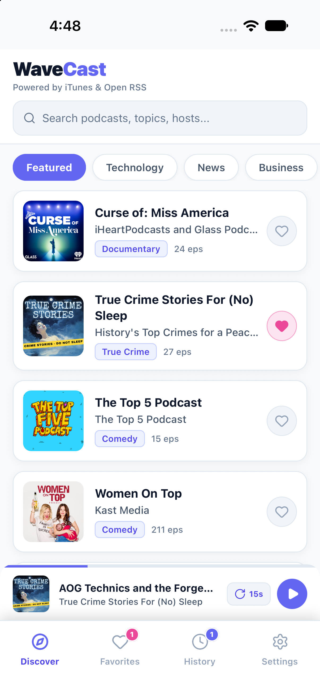

# WaveCast - React Native Podcast App

A modern, full-featured podcast streaming application bootstrapped with **React Native Community CLI** (`@react-native-community/cli`), using **100% free open APIs** (Apple iTunes Search API + direct RSS XML Feeds) and **`@rntp/player`** for native iOS & Android audio streaming and background playback.

---

## 📱 Screenshots

<p align="center">
  
  &nbsp;&nbsp;&nbsp;&nbsp;
  
</p>

---

## 🎧 Features

- **Free Podcast Discovery**: Uses the free public Apple iTunes Search API (no API key or registration required) to search podcasts across categories (Technology, News, Business, True Crime, Comedy, Science).
- **Direct RSS Feed Parsing**: Fetches podcast RSS XML directly and parses episode audio enclosures (`<enclosure url="..." />`), titles, release dates, durations, and show notes using `fast-xml-parser`.
- **Native Audio Streaming**: Uses `@rntp/player` for audio playback directly from publishers' MP3/AAC streams.
- **Background & Lock Screen Controls**: Plays audio in the background with lock screen & notification bar controls (`FOREGROUND_SERVICE` and `FOREGROUND_SERVICE_MEDIA_PLAYBACK` configured on Android).
- **Interactive UI**:
  - Category filter pills
  - Fast search with instant suggestions and clear button
  - Podcast detail view with full episode list and release metadata
  - Docked Mini Player with real-time progress bar and quick +15s jump
  - Full-Screen Player Modal with scrubber, speed controls (1x, 1.25x, 1.5x, 2x), and episode notes

---

## 🛠 Project Architecture

```
Podcast/
├── android/               # Android native project files
│   └── app/src/main/AndroidManifest.xml (Configured with audio foreground service)
├── src/
│   ├── components/
│   │   ├── CategoryPills.tsx     # Category chips (Technology, News, etc.)
│   │   ├── EpisodeItem.tsx       # Episode list item with play indicator
│   │   ├── FullPlayerModal.tsx   # Scrubber, 15s skip, speed controls, notes
│   │   ├── MiniPlayer.tsx        # Bottom docked mini player with progress
│   │   └── PodcastCard.tsx       # Podcast cover & metadata card
│   ├── services/
│   │   ├── podcastApi.ts         # iTunes API search + RSS XML parser
│   │   └── playerService.ts      # Audio player setup, play, pause, seek, jump
│   └── types/
│       └── podcast.ts            # Podcast & Episode interfaces
├── service.ts             # Remote background media controls service
├── index.js               # App entrypoint + TrackPlayer service registration
├── App.tsx                # Main screen & state management
└── package.json
```

---

## 🚀 Running on Android

### 1. Start Metro Bundler
```bash
npm start
```

### 2. Run on Android Emulator or Device
Open another terminal tab and run:
```bash
npm run android
```
*(Make sure an Android Emulator is running or an Android device is connected via USB with USB debugging enabled).*

---

## 🌐 Free API Reference

### Apple iTunes Search API
```
GET https://itunes.apple.com/search?term={QUERY}&media=podcast&entity=podcast&limit=25
```
Returns podcast metadata and direct RSS `feedUrl`.

### Podcast RSS Feed (XML)
Every podcast host serves an RSS feed containing episode media links:
```xml
<item>
  <title>Episode Title</title>
  <enclosure url="https://.../episode.mp3" type="audio/mpeg" length="123456" />
</item>
```
The app parses the MP3 URL and hands it directly to `TrackPlayer` to stream for free.
